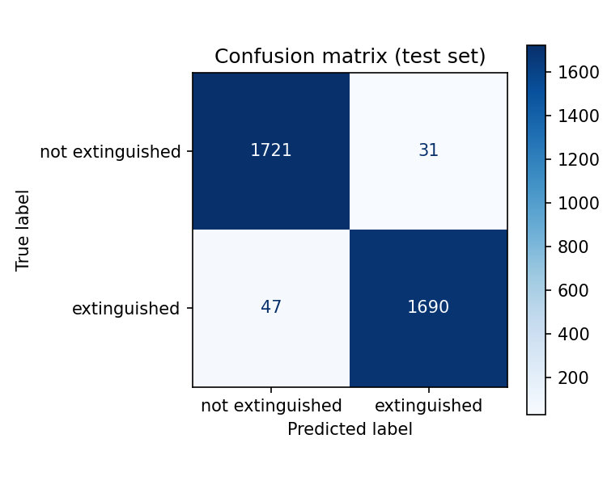
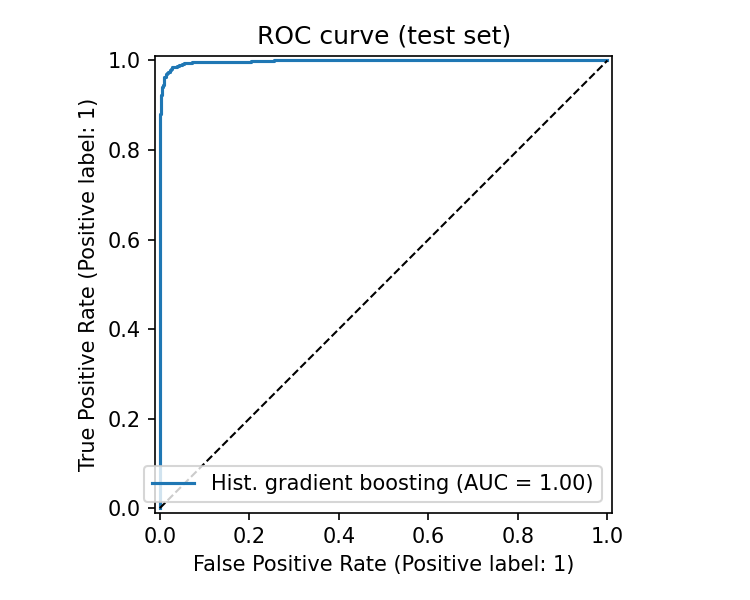
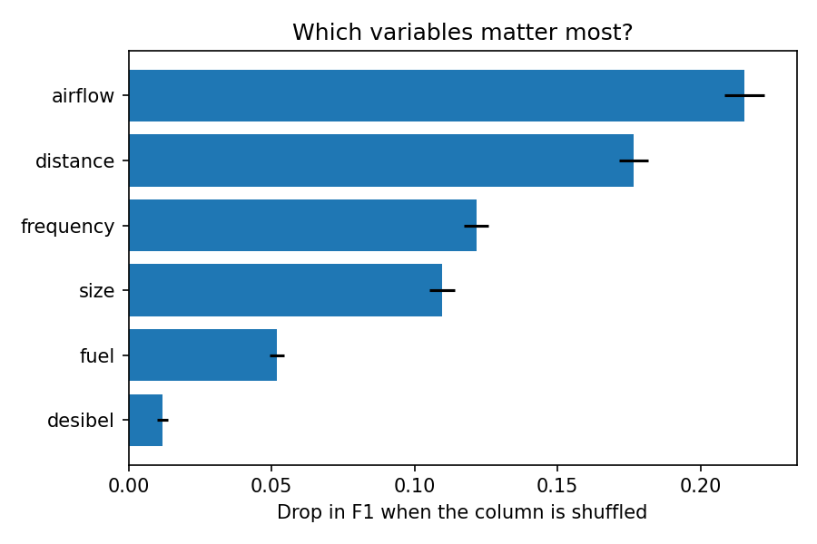

# Predicting flame extinction with sound waves

Binary classification: given the settings of an acoustic extinguisher experiment, will the flame go out?

Machine Learning course project (ISEC, Coimbra, 2025/26), pair project. This repository holds the modelling stage, rebuilt as a single reproducible scikit-learn pipeline.

## Data

Acoustic Extinguisher Fire Dataset (public; see the citation request file that comes with it): 17,442 experiments, 7 variables.

| Variable | Meaning |
|---|---|
| `size` | Size of the flame container (ordinal, 1 to 7) |
| `fuel` | Fuel type (gasoline, thinner, kerosene, LPG) |
| `distance` | Distance between the sound source and the flame (cm) |
| `desibel` | Sound level (dB); spelling as in the dataset |
| `airflow` | Air flow produced by the sound wave (m/s) |
| `frequency` | Sound frequency (Hz) |
| `status` | Target: 1 = flame extinguished, 0 = not extinguished |

The classes are balanced (about 50% extinguished), so accuracy and F1 are both meaningful.

## Method

All steps live in one `Pipeline`, so everything learned from the data comes from the training folds only (no data leakage):

1. Stratified 80/20 train/test split (`random_state=42`).
2. Custom transformer: IQR winsorisation (limits fitted on training data, no rows removed) and two engineered features, `energy_index = desibel × airflow` and `intensity_per_size = desibel / size`.
3. One-hot encoding of `fuel`, standardisation of the numeric columns.
4. 5-fold stratified cross-validation on the training set to compare four models.
5. Randomised hyperparameter search (15 candidates, F1) on the best tree-based model.
6. One final evaluation on the test set.

## Results

5-fold cross-validation on the training set (13,953 rows):

| Model | Accuracy | F1 | ROC AUC |
|---|---|---|---|
| Baseline (most frequent class) | 0.502 | 0.000 | 0.500 |
| Logistic regression | 0.903 | 0.901 | 0.969 |
| Random forest | 0.965 | 0.965 | 0.995 |
| Histogram gradient boosting | 0.971 | 0.971 | 0.997 |

Gradient boosting won and was tuned (best: `max_leaf_nodes=63`, `max_iter=400`, `learning_rate=0.1`, `l2_regularization=0.1`), reaching a CV F1 of 0.974.

Held-out test set (3,489 rows, used once):

| Class | Precision | Recall | F1 |
|---|---|---|---|
| Not extinguished | 0.97 | 0.98 | 0.98 |
| Extinguished | 0.98 | 0.97 | 0.98 |

Accuracy 0.98 · ROC AUC 0.998





## Conclusions

- The experimental settings predict extinction very well: the tuned model is right about 98% of the time, against 50% for a baseline that always guesses one class.
- Non-linear models clearly beat logistic regression (0.90 → 0.97 accuracy), so the relationship between the settings and extinction is not linear.
- Precision and recall are almost identical for both classes, so the model does not favour one error type over the other.
- Test and cross-validation scores agree, which suggests the model is not overfitting to the training set.
- Airflow and distance matter most: shuffling either one drops the F1 score by roughly 0.2, followed by frequency and size (about 0.1 each). Fuel type matters less (about 0.05) and the sound level in decibels has the smallest effect (about 0.01). Permutation importance can understate variables that carry overlapping information, so this is a ranking of how much the model relies on each column, not proof of physical cause.
- Limitation: the data come from controlled laboratory runs with a fixed set of fuels and distances, so the result says nothing about how the model would behave on conditions outside that range.

## Run it

```
pip install pandas numpy scikit-learn matplotlib openpyxl
python ml_milestone2_modelling.py data/Acoustic_Extinguisher_Fire_Dataset.xlsx
```

Metrics, tables and figures are written to `results/`.

## Stack

Python, pandas, NumPy, scikit-learn, Matplotlib.
